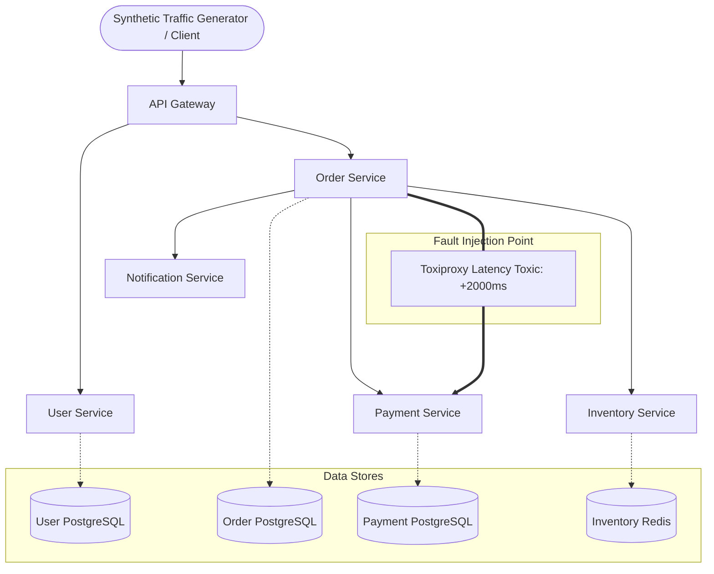

# Problem Statement & Product Vision

## 1. Problem Statement

Modern microservice architectures introduce high operational complexity. In distributed systems composed of dozens or hundreds of autonomous services, failures rarely manifest as simple, isolated crashes. Instead, failures propagate across network boundaries, cascading through synchronous Remote Procedure Calls (RPCs), saturating thread pools, depleting database connection pools, and triggering unpredictable tail-latency spikes.

Engineering organizations face three fundamental bottlenecks when attempting to achieve distributed system resilience:

1. **Inability to Safely Validate Failure Modes Before Production:**
   Traditional testing (unit, integration, end-to-end) validates happy paths and expected error codes under static conditions. However, real-world outages arise from non-deterministic conditions: network packet drops, transient latency spikes, thread starvation, connection pool exhaustion, and asynchronous message queue lag. Without an automated, isolated platform to safely inject controlled faults into running topologies, teams deploy unverified fallback logic and circuit breakers straight to production.

2. **Alert Fatigue and High Mean Time to Resolution (MTTR):**
   When a downstream service degrades (e.g., a Payment Gateway experiencing high latency), upstream services (Order Service, Checkout Service, API Gateway) experience queue backups, connection timeouts, and cascading 504 errors. Monitoring tools generate hundreds of simultaneous alerts across the service graph. On-call engineers are inundated with symptoms rather than causes, wasting critical minutes manually tracing cross-service call trees, checking log streams, and cross-referencing dashboards.

3. **Superficial and Hallucinatory AI Tools in Infrastructure Operations:**
   Current attempts to introduce Generative AI into Site Reliability Engineering (SRE) suffer from severe flaws: LLMs are fed massive uncurated dumps of raw logs and asked "What went wrong?". Without deterministic telemetry grounding, topology-aware dependency traversal, and temporal correlation, LLMs routinely hallucinate causes, confuse downstream symptoms with root causes, and propose dangerous or irrelevant remediation commands.

---

## 2. Product Vision

The **AI Root Cause Analysis & Chaos Engineering Platform** is an enterprise-grade, multi-tenant engineering platform engineered to bridge the gap between active resilience testing and deterministic, evidence-grounded incident analysis.

The platform provides a closed-loop engineering workflow:
```
Define Topology ➔ Provision Kubernetes Sandbox ➔ Deploy Workloads ➔ 
Inject Controlled Chaos ➔ Ingest High-Cardinality Telemetry ➔ 
Detect Incidents ➔ Deterministic Root Cause Analysis ➔ 
Evidence-Grounded AI Explanation & Remediation ➔ Post-Mortem Report
```

### Core Value Propositions
- **True Environmental Isolation:** Developers define realistic microservice topologies and spin up isolated Kubernetes sandboxes on demand, fortified with strict Linux cgroup resource limits, NetworkPolicies, and RBAC controls.
- **Precision Chaos Engineering:** Rather than destructive, unconstrained host-level killing, the platform leverages protocol-aware proxies (Toxiproxy) and containerized stress injectors to introduce precise network latency, jitter, packet loss, bandwidth bottlenecks, and compute starvation with sub-second rollback capabilities.
- **Deterministic-First Root Cause Analysis (RCA):** The system does not ask an LLM to guess what broke. A deterministic algorithmic engine cross-references service dependency graphs, temporal event timelines, distributed trace spans, and metric anomaly vectors to identify candidate root causes with mathematically calibrated confidence scores.
- **Evidence-Grounded AI Synthesis:** LLMs (via Groq / compatible providers) are strictly bounded to an "Evidence Pack" generated by the deterministic engine. The LLM translates structured causal graphs into executive summaries, detailed technical post-mortems, and actionable remediation runbooks with zero hallucination of underlying telemetry.

---

## 3. Target Users & User Personas

| Persona | Role | Key Objectives | Frustrations |
| :--- | :--- | :--- | :--- |
| **P1: Site Reliability Engineer (SRE)** | Production Health & Incident Commander | Minimize MTTR, establish actionable SLO/SLI error budgets, prevent recurring outages. | Alert fatigue, lack of cross-service trace correlation during fires, lack of reproducible failure environments. |
| **P2: Platform Engineer** | Internal Developer Platform Owner | Provide self-service, secure, and isolated development and testing environments on Kubernetes. | Tenants consuming unbounded cluster resources, manual namespace setup, lack of multi-tenant security boundaries. |
| **P3: Microservice Backend Developer** | Service Author (e.g., Order / Payment) | Verify resilience patterns (circuit breakers, timeouts, retries, fallback caches) prior to merging code. | Hard to simulate network partitions and downstream degradation locally; unit tests cannot capture distributed timing bugs. |
| **P4: Engineering Leader / Director** | VP / Head of Infrastructure | Quantify architectural resilience, establish automated post-mortem documentation, reduce outage costs. | Inconsistent incident post-mortems, slow onboarding of junior engineers, lack of verifiable resilience metrics. |

---

## 4. End-to-End User Journeys

### Journey 1: SRE Proactively Validating Circuit Breakers (Chaos Execution)
1. **Define Topology:** SRE registers a multi-tier e-commerce topology via the UI or API (API Gateway $\to$ Order Service $\to$ Payment Service $\to$ Third-Party PSP).
2. **Deploy Sandbox:** SRE requests an isolated Kubernetes sandbox; the platform provisions an isolated namespace with strict resource quotas, NetworkPolicies, and deploys the instrumented microservices alongside Toxiproxy sidecars.
3. **Configure & Inject Fault:** SRE configures a chaos experiment: "Inject 2,000ms latency + 500ms jitter on Payment Service ingress for 3 minutes under a synthetic 50 RPS load."
4. **Observe Degradation:** SRE monitors real-time telemetry: Order Service connection pool saturates; queue length spikes; circuit breaker trips from CLOSED to OPEN after 15 consecutive timeouts.
5. **Clean Verification:** The platform automatically reaches experiment duration, tears down the Toxiproxy toxic, verifies network recovery, and confirms normal service restoration.

### Journey 2: Developer Investigating an Automated Incident (Deterministic RCA + AI)
1. **Incident Trigger:** During the experiment, latency on Order Service exceeds the 500ms P99 SLO threshold, triggering an alert rule.
2. **Deterministic Correlation:** The platform captures an Incident Evidence Pack:
   - Identifies alert timestamp $T_0$.
   - Scans Prometheus for metrics exceeding baseline anomalies within $[T_0 - 2\text{m}, T_0 + 1\text{m}]$.
   - Traverses the OpenTelemetry distributed trace tree: locates root trace spans exhibiting `HTTP 504 Gateway Timeout` originating from `payment-service.checkout.internal`.
   - Traverses the topological dependency graph: recognizes that Order Service depends synchronously on Payment Service.
3. **Causal Graph Construction:** The Deterministic Engine scores candidate causes:
   - Candidate 1 (`payment-service` network latency): Confidence Score = 0.94.
   - Candidate 2 (`order-service` thread starvation): Confidence Score = 0.42 (flagged as downstream symptom).
4. **AI Generation:** The Evidence Pack is fed into the LLM Engine via a strictly constrained schema. The LLM generates:
   - Executive root cause summary.
   - Exact sequence of failure propagation.
   - Recommended remediation (e.g., tune Order Service HTTP client timeout from 5000ms to 1200ms and introduce an exponential backoff retry with jitter).
5. **Export Post-Mortem:** The developer downloads a standardized PDF/Markdown post-mortem report ready for review.

---

## 5. Concrete Scenario: The E-Commerce Microservice Topology

To ensure architectural decisions throughout this platform are concrete rather than abstract, we ground all requirements, database models, and algorithms in an industry-standard e-commerce architecture:



### The Simulated Cascading Failure Chain
1. **Fault:** Toxiproxy injects 2,000ms delay on TCP packets directed to `PaymentService:8080`.
2. **Immediate Effect:** Payment processing HTTP handler execution time jumps from 45ms to 2,045ms.
3. **First Propagation (Upstream):** Order Service maintains a thread pool of 50 worker threads for outgoing HTTP requests. Because payments now take >2s, all 50 worker threads become blocked waiting for socket reads.
4. **Cascading Symptom:** Inbound requests to `POST /orders` fail with `503 Service Unavailable` or `504 Gateway Timeout` because Order Service cannot accept new requests.
5. **Secondary Upstream Symptom:** API Gateway reports elevated 5xx error rate and alerts trigger for API Gateway and Order Service.
6. **Telemetry Footprint:**
   - Prometheus: `http_server_duration_seconds{service="order-service"}` P99 spikes to 2.1s; `active_requests` hits ceiling.
   - Jaeger: Traces show top-level span `POST /orders` (total: 2,150ms), with 95% of duration spent inside child span `POST http://payment-service:8080/v1/charge`.
   - Loki: Order Service logs contain `urllib3.exceptions.ReadTimeoutError` or `httpx.ReadTimeout`.
7. **RCA Objective:** The platform must distinguish between the *victim/symptom* (`Order Service` and `API Gateway`) and the *root cause* (`Payment Service` network transport delay).
