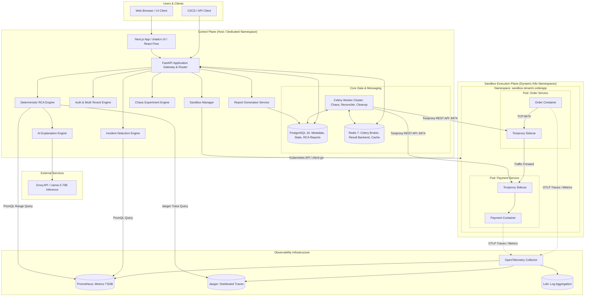
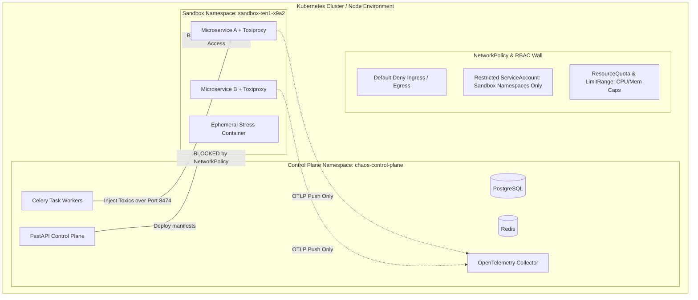
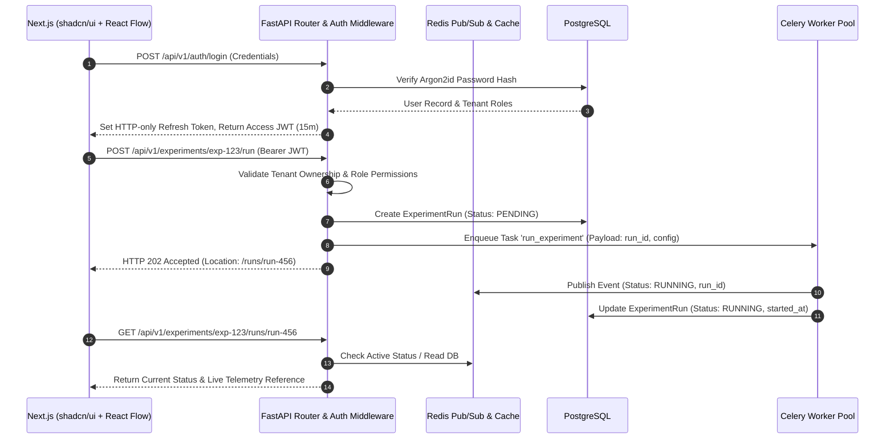
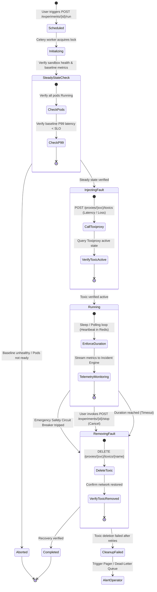
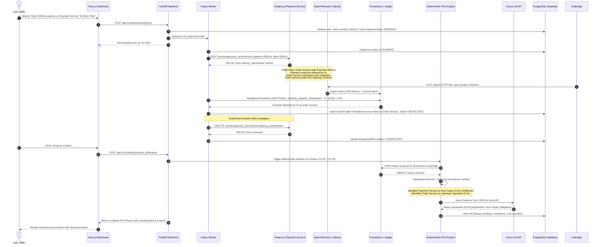

# High-Level System Architecture

## 1. Architectural Philosophy & Principles

The **AI Root Cause Analysis & Chaos Engineering Platform** is designed around clear distributed systems tenets:

1. **Strict Plane Separation (Control Plane vs. Sandbox Execution Plane):**
   The control plane (FastAPI, PostgreSQL, Redis, Celery) manages state, schedules tasks, and analyzes telemetry. The sandbox execution plane (isolated Kubernetes namespaces containing tenant microservices, Toxiproxy sidecars, and OpenTelemetry forwarders) runs the workloads subject to failure. A fault in a sandbox must **never** degrade the control plane.
2. **Modular Monolith for Control Plane:**
   Rather than fragmenting the control plane into a dozen microservices requiring complex inter-service RPCs, distributed transactions, and service meshes, the control plane is structured as a **modular Python monolith** running under FastAPI with clean domain boundaries. Asynchronous background tasks are offloaded to Celery workers via Redis.
3. **Deterministic Primacy in Root Cause Analysis:**
   Telemetry correlation and root cause ranking are mathematical and topological problems, not generative language problems. Algorithmic analysis (dependency graph traversal, anomaly onset timestamps, trace span latency decomposition) forms the single source of truth. The LLM acts solely as a specialized technical synthesizer and documentarian grounded in deterministic evidence.
4. **Idempotency and Safe Failure Recovery:**
   All infrastructure mutating operations (creating a namespace, injecting a toxic, terminating an experiment) are idempotent. If a background worker crashes mid-experiment, the system reconciles orphaned resources automatically via state heartbeats in Redis and cleanup sweeps.

---

## 2. High-Level Architecture Diagrams

### Diagram 1: Overall System Architecture



---

### Diagram 2: Control Plane vs. Sandbox Execution Plane Isolation



---

### Diagram 3: Frontend-to-Backend Communication Architecture



---

### Diagram 4: Experiment Execution Lifecycle



---

### Diagram 5: Telemetry Ingestion Pipeline

```mermaid
flowchart LR
    subgraph MicroservicePods [Sandbox Microservices]
        App1[Order Service + OTel SDK]
        App2[Payment Service + OTel SDK]
        App3[Inventory Service + OTel SDK]
    end

    subgraph Sidecars [Network Layer]
        Toxi1[Toxiproxy Ingress Proxy]
        Toxi2[Toxiproxy Ingress Proxy]
    end

    subgraph OTelCollector [OpenTelemetry Collector Service]
        Receiver[OTLP Receiver: gRPC 4317 / HTTP 4318]
        Batcher[Batch & Memory Limiter Processor]
        AttrProcessor[Attribute Processor: inject tenant_id, sandbox_id]
        ExporterProm[Prometheus Exporter: /metrics]
        ExporterJaeger[OTLP gRPC Exporter]
        ExporterLoki[Loki Exporter]
    end

    subgraph ObservabilityStorage [Observability Backends]
        PrometheusServer[Prometheus Server (TSDB)]
        JaegerServer[Jaeger Collector & Storage]
        LokiServer[Grafana Loki Log Storage]
    end

    App1 -- Traces & Metrics --> Receiver
    App2 -- Traces & Metrics --> Receiver
    App3 -- Traces & Metrics --> Receiver

    Receiver --> Batcher --> AttrProcessor
    AttrProcessor --> ExporterProm --> PrometheusServer
    AttrProcessor --> ExporterJaeger --> JaegerServer
    AttrProcessor --> ExporterLoki --> LokiServer
```

---

### Diagram 6: Incident Detection and Root Cause Analysis Workflow

```mermaid
flowchart TD
    subgraph Detection [Incident Detection Phase]
        EvalLoop[Incident Evaluator Loop (Runs every 5s)]
        EvalLoop -->|Query PromQL| PromMetrics[Prometheus: Query P99 Latency & 5xx Rate]
        PromMetrics --> ThresholdCheck{SLO Breached? \n Latency > 500ms or 5xx > 5%}
        ThresholdCheck -- No --> Continue[Continue Polling]
        ThresholdCheck -- Yes --> TriggerIncident[Create Incident Entity in PostgreSQL \n Status: DETECTED, Timestamp: T0]
    end

    subgraph TelemetryGathering [Evidence Collection Phase]
        TriggerIncident --> QueryWindow[Define Analysis Window: T0 - 2m to T0 + 1m]
        QueryWindow --> PullTraces[Pull Error & Outlier Traces from Jaeger]
        QueryWindow --> PullPromAnomalies[Calculate Z-Score Metric Anomalies across all services]
        QueryWindow --> FetchTopology[Retrieve Service Dependency Graph DAG from DB]
    end

    subgraph DeterministicRCA [Deterministic RCA Engine]
        PullTraces & PullPromAnomalies & FetchTopology --> CausalCorrelator[Algorithmic Causal Correlator]
        CausalCorrelator --> Step1[1. Temporal Alignment: Which service degraded FIRST?]
        Step1 --> Step2[2. Trace Span Breakdown: In which span was self-time spent?]
        Step2 --> Step3[3. Graph Direction: Traversal from Symptom to Origin]
        Step3 --> ScoreCandidates[Compute Confidence Scores: \n Score = w1*Temporal + w2*SpanTime + w3*Topology]
        ScoreCandidates --> RankCandidates[Rank Candidates: \n 1. Payment Service: 0.94 \n 2. Order Service: 0.41 (Symptom)]
    end

    subgraph AISynthesis [AI Grounding & Synthesis Phase]
        RankCandidates --> BuildEvidencePack[Build Immutable Evidence Pack JSON]
        BuildEvidencePack --> LLMPrompt[Inject into Strict Pydantic LLM Prompt]
        LLMPrompt --> GroqAPI[Groq API: Llama-3-70B Structured Output]
        GroqAPI --> SchemaValidation{Validates against \n Pydantic Schema?}
        SchemaValidation -- No --> RetryPrompt[Retry with Error Feedback]
        SchemaValidation -- Yes --> HallucinationGuard{All cited services & metrics \n match Evidence Pack?}
        HallucinationGuard -- Fail --> RejectAI[Mark AI explanation Untrusted / Fallback]
        HallucinationGuard -- Pass --> PersistReport[Persist RCA Report in PostgreSQL]
    end
```

---

### Diagram 7: Complete End-to-End Request Lifecycle



---

## 3. Deep-Dive Component Specifications (Components A through M)

### Component A: Frontend Application
- **Problem it Solves:** Provides engineers with an intuitive, unified interface to design complex distributed topologies, configure and trigger chaos experiments, observe live telemetry streams, and inspect incident post-mortems.
- **Why it Exists:** Direct API interaction for graph-based topologies and distributed traces is error-prone. Visual representation of service DAGs and real-time metric charts drastically reduces cognitive load during incidents.
- **Responsibilities:**
  - Render interactive node-edge service topology graphs (via React Flow).
  - Stream experiment execution progress and live telemetry metrics (via Recharts).
  - Present incident timelines, trace span waterfalls, and root cause confidence matrices.
  - Render dark-mode-first engineering UI components using shadcn/ui and Tailwind CSS.
- **Dependencies:** Control Plane REST API (FastAPI), WebSockets / Server-Sent Events for streaming state.
- **Input & Output:**
  - Input: User interactions, form inputs, topology drag-and-drop, API JSON responses.
  - Output: HTTP requests with Bearer JWT tokens, canvas state serialization.
- **Failure Scenarios:**
  - Network disconnect from backend: UI transitions into an offline banner mode; optimistic state updates are rolled back; auto-reconnect logic polls health endpoints.
  - Token expiration: Interceptor catches `401 Unauthorized`, initiates silent refresh via `/api/v1/auth/refresh`; redirects to `/login` if refresh fails.
- **Security Considerations:**
  - Zero storage of raw JWT tokens in browser `localStorage` or `sessionStorage` (vulnerable to XSS). Short-lived tokens kept in memory; refresh tokens stored in `HttpOnly; Secure; SameSite=Strict` cookies.

### Component B: API and Authentication Layer
- **Problem it Solves:** Serves as the secure entry point for all control plane interactions, handling request validation, authentication, authorization, and rate limiting.
- **Why it Exists:** Prevents unauthorized access, enforces tenant boundaries, and protects downstream workers from malformed or malicious payloads.
- **Responsibilities:**
  - Terminate client TLS and parse incoming JSON requests using Pydantic models.
  - Authenticate requests via JWT Bearer tokens; verify signature, expiration, and issuer.
  - Enforce tenant isolation via scoped dependency injection in FastAPI.
  - Enforce role-based access control (RBAC): `TenantOwner`, `Engineer`, `Viewer`.
  - Rate-limit incoming requests per tenant/IP using Redis token buckets.
- **Dependencies:** PostgreSQL (user credentials and permissions), Redis (token revocation blacklist and rate-limit counters).
- **Input & Output:**
  - Input: HTTP requests (JSON payloads, query parameters, Authorization headers).
  - Output: Structured JSON responses with standard status codes (`200 OK`, `201 Created`, `202 Accepted`, `400 Bad Request`, `401 Unauthorized`, `403 Forbidden`, `404 Not Found`, `422 Unprocessable Entity`).
- **Failure Scenarios:**
  - Database unreachable during auth: FastAPI returns `503 Service Unavailable` with `Retry-After: 10`.
  - Redis cache down: Rate-limiter fails open gracefully with audit warnings while falling back to database token verification.
- **Security Considerations:**
  - Passwords hashed with Argon2id ($m=65536, t=3, p=4$). Constant-time hash verification.
  - Strict input sanitization preventing SQL injection, path traversal, and command injection.

### Component C: Tenant and Project Management
- **Problem it Solves:** Organizes infrastructure, topologies, and experiment records into logical multi-tenant domains.
- **Why it Exists:** Enterprises require strict logical segregation between teams, departments, and customer accounts to prevent cross-contamination of experiments and data leaks.
- **Responsibilities:**
  - Manage lifecycle of Tenants, Projects, and Memberships.
  - Generate unique tenant slugs and enforce unique project identifiers per tenant.
  - Maintain audit logs for all administrative actions (invitations, role changes, project deletions).
- **Dependencies:** PostgreSQL (relational storage).
- **Input & Output:**
  - Input: Tenant creation payloads, project schemas, user invitation requests.
  - Output: Serialized tenant and project models with associated member roles.
- **Failure Scenarios:**
  - Concurrent creation of duplicate project slugs within a tenant: Handled via unique composite index `(tenant_id, slug)` and database constraint error translation to `409 Conflict`.
- **Security Considerations:**
  - Every SQL query executes with an explicit `WHERE tenant_id = :current_tenant_id` filter injected via FastAPI dependency dependencies.

### Component D: Sandbox Manager
- **Problem it Solves:** Automates the lifecycle of isolated Kubernetes environments where microservice topologies are deployed and subjected to chaos.
- **Why it Exists:** Manually provisioning namespaces, configuring deployments, injecting sidecars, and setting up network security for every experiment is slow and prone to human error.
- **Responsibilities:**
  - Translate declarative topology models into Kubernetes manifests (Deployments, Services, ConfigMaps).
  - Provision dynamic namespaces following naming format `sandbox-{tenant_short_id}-{sandbox_uuid}`.
  - Inject Toxiproxy sidecar containers into every workload pod specification.
  - Configure `ResourceQuota`, `LimitRange`, and default-deny `NetworkPolicy` per sandbox.
  - Execute background reconciliation loops to detect and purge stale or leaked sandboxes.
- **Dependencies:** Kubernetes API Server, Kubernetes Python Client, PostgreSQL.
- **Input & Output:**
  - Input: Service Topology definition and resource sizing parameters.
  - Output: Live Kubernetes namespace identifier, service DNS endpoints, and status (`PROVISIONING`, `READY`, `FAILED`, `TERMINATING`).
- **Failure Scenarios:**
  - Kubernetes cluster resource exhaustion: Namespace creation succeeds but pods enter `Pending` state due to `InsufficientMemory` or `InsufficientCPU`. The manager detects this timeout ($> 120\text{s}$), updates sandbox status to `FAILED`, and automatically triggers resource cleanup.
- **Security Considerations:**
  - Sandbox workloads are forbidden from mounting host volumes (`hostPath`), using host networking (`hostNetwork: false`), or running as root (`runAsNonRoot: true`).

### Component E: Kubernetes Integration Layer
- **Problem it Solves:** Encapsulates all raw interactions with the Kubernetes API behind clean, typed Python interfaces.
- **Why it Exists:** Isolates the rest of the application from Kubernetes client idiosyncrasies, API version changes, and connection lifecycle management.
- **Responsibilities:**
  - Manage connection pooling to the Kubernetes API server using in-cluster ServiceAccount tokens or local kubeconfig (Kind).
  - Provide asynchronous helper methods for CRUD operations on Namespaces, Deployments, Services, and NetworkPolicies.
  - Implement watch loops with exponential backoff for tracking pod rollout status.
- **Dependencies:** `kubernetes_asyncio` / official Kubernetes Python client.
- **Input & Output:**
  - Input: Strongly typed manifest definitions (Pydantic models representing K8s specs).
  - Output: Kubernetes API response objects and status events.
- **Failure Scenarios:**
  - Transient Kubernetes API unavailability: Implements retry logic with exponential backoff and jitter (maximum 3 retries over 10 seconds).
- **Security Considerations:**
  - The control plane's Kubernetes `ServiceAccount` uses strict ClusterRole bindings restricted solely to managing resources inside namespaces matching the `sandbox-*` regex.

### Component F: Chaos Experiment Engine
- **Problem it Solves:** Orchestrates the injection, monitoring, duration enforcement, and clean removal of physical and network faults.
- **Why it Exists:** Fault injection must be precisely calibrated, strictly time-bounded, and guaranteed to recover cleanly without operator intervention.
- **Responsibilities:**
  - Validate experiment parameters against safety guardrails (e.g., maximum latency $\le 5,000\text{ms}$, maximum duration $\le 600\text{s}$).
  - Establish connections to target Toxiproxy sidecar instances via internal cluster networking.
  - Inject network faults (latency, jitter, bandwidth limitation, packet drop).
  - Trigger pod restarts or deploy ephemeral compute stress containers (stress-ng).
  - Enforce strict experiment timeouts and execute immediate fault rollback upon stop commands.
  - Verify that network metrics return to steady-state baselines post-cleanup.
- **Dependencies:** Toxiproxy HTTP REST API (port 8474), Celery Background Workers, Redis, Kubernetes API.
- **Input & Output:**
  - Input: Experiment definition (Target Service, Fault Type, Duration, Parameters).
  - Output: Execution telemetry, state transition logs, and final run outcome (`COMPLETED`, `ABORTED`, `FAILED`).
- **Failure Scenarios:**
  - Toxiproxy sidecar crashes while toxic is active: The worker detects connection failure, queries the Kubernetes API to restart the pod, and clears the toxic from state.
- **Security Considerations:**
  - Global Kill Switch: An emergency endpoint that immediately flushes all active toxics across all sandboxes within a tenant.

### Component G: Background Worker System
- **Problem it Solves:** Executes long-running, asynchronous, and scheduled tasks without blocking web API request threads.
- **Why it Exists:** Operations like provisioning a 6-node Kubernetes cluster (45s), running a 5-minute chaos experiment, and performing heavy trace correlation queries cannot execute inside synchronous HTTP request-response cycles.
- **Responsibilities:**
  - Manage distributed task queues (Queues: `chaos_execution`, `reconciliation`, `telemetry_eval`, `reports`).
  - Maintain distributed task locks and heartbeats in Redis to prevent duplicate task execution.
  - Monitor running experiments and enforce automatic termination if workers miss heartbeats.
- **Dependencies:** Celery, Redis (Message Broker & Result Backend), PostgreSQL.
- **Input & Output:**
  - Input: Serialized task names and argument payloads.
  - Output: Task status updates, database records, and Redis pub/sub notifications.
- **Failure Scenarios:**
  - Worker process killed abruptly (`SIGKILL` / OOM): Celery's `task_acks_late=True` combined with a central watchdog worker detects orphaned tasks whose heartbeat expired and re-queues them or triggers automated cleanup.
- **Security Considerations:**
  - Task arguments contain only entity IDs (`run_id`, `sandbox_id`), never sensitive passwords or plaintext secrets.

### Component H: Observability Pipeline
- **Problem it Solves:** Collects, enriches, and stores metrics, traces, and logs emitted by sandbox microservices.
- **Why it Exists:** High-cardinality distributed telemetry is the foundational fuel required for both incident detection and deterministic root cause analysis.
- **Responsibilities:**
  - Deploy OpenTelemetry Collector with OTLP gRPC/HTTP receivers.
  - Enrich incoming spans and metrics with infrastructure metadata (`tenant_id`, `sandbox_id`, `experiment_id`).
  - Forward metrics to Prometheus, traces to Jaeger, and logs to Loki.
  - Expose query APIs for control plane services.
- **Dependencies:** OpenTelemetry Collector, Prometheus, Jaeger, Loki.
- **Input & Output:**
  - Input: OTLP protobuf payloads over gRPC (port 4317) and HTTP (port 4318).
  - Output: PromQL-queryable time series, Jaeger trace span trees, LogQL streams.
- **Failure Scenarios:**
  - High telemetry burst saturates collector memory: OTel Collector's `memory_limiter` processor initiates controlled span dropping to protect collector stability while alerting operators.
- **Security Considerations:**
  - Strict network ingress policies: OTel Collector accepts telemetry only from registered sandbox namespaces.

### Component I: Incident Detection Engine
- **Problem it Solves:** Automatically detects performance degradation, SLO violations, and outages in real time during experiments.
- **Why it Exists:** Replaces manual human dashboard inspection with continuous, algorithmic evaluation of service health.
- **Responsibilities:**
  - Periodically evaluate sliding-window PromQL queries against Prometheus during active experiment runs.
  - Detect latency anomalies (P99 $> \text{threshold}$ for $> 30\text{s}$) and error rate spikes ($5\text{xx} > 5\%$).
  - Deduplicate alerts occurring across dependent services into a single unified `Incident` record.
  - Snapshot initial incident evidence (onset timestamp, affected service, breaching metric values).
- **Dependencies:** Prometheus API, PostgreSQL, Redis.
- **Input & Output:**
  - Input: Metric time series and SLO threshold rules.
  - Output: `Incident` record stored in PostgreSQL with status `DETECTED`.
- **Failure Scenarios:**
  - Prometheus temporarily unreachable: Evaluator retries with backoff; if downtime exceeds 30 seconds, an alert is flagged indicating observability gap.
- **Security Considerations:**
  - All PromQL queries are generated internally with parameterized service names; no raw user-supplied PromQL strings are executed.

### Component J: Root Cause Analysis Engine
- **Problem it Solves:** Discovers the true originating failure point among dozens of alerting downstream services.
- **Why it Exists:** In microservice cascading failures, upstream services (API Gateway, Order Service) frequently report the highest error rates and longest latencies, masking the true downstream culprit (Payment Service).
- **Responsibilities:**
  - Perform temporal precedence analysis: identify which service exhibited the earliest statistical metric deviation ($T_{\text{anomaly}}$).
  - Traverse the topological Directed Acyclic Graph (DAG) from symptom nodes downward.
  - Analyze distributed trace spans in Jaeger to calculate "self-time" vs. "waiting-for-child time".
  - Compute normalized Root Cause Confidence Scores ($0.0 - 1.0$) for all candidate nodes.
  - Package findings into a verifiable, tamper-evident `Incident Evidence Pack`.
- **Dependencies:** Prometheus (Range queries), Jaeger (Trace queries), PostgreSQL (Topology definitions).
- **Input & Output:**
  - Input: `incident_id`, analysis time window $[T_0 - 2\text{m}, T_0 + 1\text{m}]$.
  - Output: Ranked candidate list, causal dependency tree, and supporting telemetry evidence.
- **Failure Scenarios:**
  - Incomplete trace data (dropped spans): Engine falls back to topological graph traversal and metric temporal correlation, adjusting confidence scores downward to reflect lower data completeness.
- **Security Considerations:**
  - Read-only queries against observability backends scoped strictly by `tenant_id` and `sandbox_id`.

### Component K: AI Explanation Engine
- **Problem it Solves:** Translates complex mathematical RCA scores, raw telemetry vectors, and trace trees into clear, actionable human explanations and engineering runbooks.
- **Why it Exists:** On-call engineers need rapid, understandable incident summaries and concrete mitigation steps, not just raw graph adjacency matrices.
- **Responsibilities:**
  - Construct structured, context-constrained prompts containing the `Incident Evidence Pack`.
  - Invoke LLM inference via Groq API (utilizing models like Llama-3-70B for ultra-fast, structured JSON generation).
  - Enforce Pydantic schema validation on LLM output.
  - Execute hallucination detection: verify that all mentioned service names, metric thresholds, and timestamps exist in the provided Evidence Pack.
- **Dependencies:** Groq API / OpenAI-compatible endpoint, Pydantic, PostgreSQL.
- **Input & Output:**
  - Input: Structured JSON `Incident Evidence Pack`.
  - Output: Validated JSON containing Executive Summary, Timeline, Failure Chain Narrative, and Mitigation Recommendations.
- **Failure Scenarios:**
  - LLM API outage or rate limit: System gracefully flags the incident as "Analyzed via Deterministic Engine (AI Summary Unavailable)" and presents the complete deterministic findings without blocking the user.
- **Security Considerations:**
  - Zero proprietary source code or customer PII is included in the LLM prompt. Only anonymized service names, metrics, and structural topology data are transmitted.

### Component L: Report Generation Service
- **Problem it Solves:** Assembles all incident telemetry, deterministic findings, and AI narratives into formal post-mortem reports.
- **Why it Exists:** Engineering organizations require standardized, shareable documentation for incident reviews, retrospectives, and compliance audits.
- **Responsibilities:**
  - Aggregate metadata, topology graphs, Prometheus charts, trace waterfalls, and AI explanations into a coherent document.
  - Render formatted Markdown and PDF documents.
  - Store generated reports in object storage / database and expose secure download endpoints.
- **Dependencies:** PostgreSQL, WeasyPrint / headless rendering tools, Report Templates.
- **Input & Output:**
  - Input: `incident_id`, report layout template.
  - Output: Rendered PDF binary or Markdown string.
- **Failure Scenarios:**
  - PDF rendering timeout: Returns Markdown version immediately while background worker retries document compilation.
- **Security Considerations:**
  - Download links are signed with time-limited HMAC tokens verified against the user's tenant permissions.

### Component M: PostgreSQL and Redis Infrastructure
- **Problem it Solves:** Provides ACID-compliant relational persistence for platform metadata and high-speed in-memory caching/messaging for workers.
- **Why it Exists:** The platform requires durable consistency for projects, user accounts, and experiment audit trails, combined with sub-millisecond queuing for background workers.
- **Responsibilities:**
  - PostgreSQL 16: Primary system of record for Tenants, Users, Topologies, Experiments, Runs, Incidents, and RCA Reports.
  - Redis 7: Celery message broker, task lock coordinator, rate-limit counter store, and pub/sub event bus.
- **Dependencies:** Underlying storage volumes (persistent SSDs).
- **Input & Output:**
  - PostgreSQL: SQL queries over `asyncpg` connection pool.
  - Redis: Redis commands over `redis-py` connection pool.
- **Failure Scenarios:**
  - PostgreSQL connection pool exhaustion: Handled via SQLAlchemy `pool_size=20, max_overflow=10` and aggressive connection timeout recycling (30s).
- **Security Considerations:**
  - Data at rest encrypted via LUKS / cloud-native KMS; connections encrypted via TLS 1.3. Least-privilege database user permissions enforced.
