# Database Architecture & Data Modeling

## 1. Relational Persistence Philosophy & Boundaries

The platform leverages **PostgreSQL 16** with asynchronous I/O (`asyncpg`) as its primary system of record for all stateful entities: user accounts, tenant boundaries, declarative topologies, sandbox state, experiment runs, incidents, and RCA post-mortems.

### Strict Data Separation Boundary
- **What PostgreSQL Stores:** Relational metadata, entity configurations, tenant memberships, experiment execution logs, incident summaries, deterministic RCA confidence matrices, and structured post-mortem reports.
- **What PostgreSQL NEVER Stores:**
  - Raw high-frequency time-series metrics (HTTP request histograms, CPU/memory samples). These belong strictly in **Prometheus**.
  - Raw high-volume distributed trace spans. These belong strictly in **Jaeger**.
  - Raw application container logs. These belong strictly in **Loki**.
  - Transient task queues, experiment locks, and live heartbeats. These belong strictly in **Redis**.

This separation ensures the PostgreSQL database remains lightweight, high-performance, and easily maintainable without suffering from table bloat caused by gigabytes of transient telemetry.

---

## 2. Mermaid Entity-Relationship (ER) Diagram

```mermaid
erDiagram
    TENANTS ||--o{ TENANT_MEMBERSHIPS : contains
    USERS ||--o{ TENANT_MEMBERSHIPS : belongs_to
    TENANTS ||--o{ PROJECTS : owns
    PROJECTS ||--o{ SERVICE_TOPOLOGIES : defines
    SERVICE_TOPOLOGIES ||--o{ SERVICES : includes
    SERVICES ||--o{ SERVICE_DEPENDENCIES : originates
    SERVICES ||--o{ SERVICE_DEPENDENCIES : targets
    PROJECTS ||--o{ SANDBOXES : provisions
    SERVICE_TOPOLOGIES ||--o{ SANDBOXES : instantiates
    SANDBOXES ||--o{ EXPERIMENTS : targets
    EXPERIMENTS ||--o{ EXPERIMENT_RUNS : executes
    EXPERIMENT_RUNS ||--o{ INCIDENTS : triggers
    INCIDENTS ||--o{ INCIDENT_EVIDENCE : contains
    INCIDENTS ||--o{ RCA_REPORTS : produces
    TENANTS ||--o{ AUDIT_LOGS : records
    USERS ||--o{ AUDIT_LOGS : performs

    TENANTS {
        uuid id PK
        varchar slug UK
        varchar name
        varchar tier
        timestamptz created_at
        timestamptz updated_at
    }

    USERS {
        uuid id PK
        varchar email UK
        varchar hashed_password
        varchar full_name
        boolean is_active
        boolean is_superuser
        timestamptz created_at
        timestamptz updated_at
    }

    TENANT_MEMBERSHIPS {
        uuid id PK
        uuid tenant_id FK
        uuid user_id FK
        varchar role
        timestamptz created_at
    }

    PROJECTS {
        uuid id PK
        uuid tenant_id FK
        varchar slug
        varchar name
        text description
        timestamptz created_at
        timestamptz updated_at
    }

    SERVICE_TOPOLOGIES {
        uuid id PK
        uuid tenant_id FK
        uuid project_id FK
        varchar name
        integer version
        jsonb graph_layout
        timestamptz created_at
    }

    SERVICES {
        uuid id PK
        uuid tenant_id FK
        uuid topology_id FK
        varchar name
        varchar image
        integer container_port
        jsonb env_vars
        jsonb resource_limits
        timestamptz created_at
    }

    SERVICE_DEPENDENCIES {
        uuid id PK
        uuid tenant_id FK
        uuid topology_id FK
        uuid source_service_id FK
        uuid target_service_id FK
        varchar protocol
        varchar dependency_type
    }

    SANDBOXES {
        uuid id PK
        uuid tenant_id FK
        uuid project_id FK
        uuid topology_id FK
        varchar k8s_namespace UK
        varchar status
        timestamptz expires_at
        timestamptz created_at
        timestamptz updated_at
    }

    EXPERIMENTS {
        uuid id PK
        uuid tenant_id FK
        uuid project_id FK
        varchar name
        text description
        varchar fault_type
        jsonb configuration
        integer duration_seconds
        timestamptz created_at
        timestamptz updated_at
    }

    EXPERIMENT_RUNS {
        uuid id PK
        uuid tenant_id FK
        uuid experiment_id FK
        uuid sandbox_id FK
        uuid triggered_by_user_id FK
        varchar status
        timestamptz started_at
        timestamptz completed_at
        text failure_reason
        jsonb telemetry_snapshot
    }

    INCIDENTS {
        uuid id PK
        uuid tenant_id FK
        uuid experiment_run_id FK
        uuid sandbox_id FK
        varchar title
        varchar severity
        varchar status
        timestamptz detected_at
        timestamptz resolved_at
    }

    INCIDENT_EVIDENCE {
        uuid id PK
        uuid tenant_id FK
        uuid incident_id FK
        varchar evidence_type
        varchar source_system
        jsonb raw_payload
        timestamptz captured_at
    }

    RCA_REPORTS {
        uuid id PK
        uuid tenant_id FK
        uuid incident_id FK
        uuid primary_root_cause_service_id FK
        float root_cause_confidence
        jsonb candidate_rankings
        jsonb causal_chain
        jsonb llm_executive_summary
        jsonb remediation_runbook
        varchar report_format_version
        timestamptz generated_at
    }

    AUDIT_LOGS {
        uuid id PK
        uuid tenant_id FK
        uuid user_id FK
        varchar action
        varchar resource_type
        uuid resource_id
        inet client_ip
        jsonb details
        timestamptz created_at
    }
```



---

## 3. Comprehensive Table Specifications

### 3.1 Table: `tenants`
- **Purpose:** Represents the top-level organization boundary for multi-tenancy.
- **Tenant Ownership:** Root organization entity.
| Column | Type | Nullable | Constraints & Defaults | Description |
| :--- | :--- | :--- | :--- | :--- |
| `id` | `UUID` | No | `PRIMARY KEY, DEFAULT gen_random_uuid()` | Unique tenant identifier. |
| `slug` | `VARCHAR(64)` | No | `UNIQUE` | URL-safe identifier (e.g., `acme-corp`). |
| `name` | `VARCHAR(255)` | No | | Display name of the tenant organization. |
| `tier` | `VARCHAR(32)` | No | `DEFAULT 'standard'` | Plan tier (`standard`, `enterprise`). |
| `created_at` | `TIMESTAMPTZ` | No | `DEFAULT NOW()` | Record creation timestamp. |
| `updated_at` | `TIMESTAMPTZ` | No | `DEFAULT NOW()` | Record update timestamp. |

### 3.2 Table: `users`
- **Purpose:** Represents human users who authenticate to the platform.
| Column | Type | Nullable | Constraints & Defaults | Description |
| :--- | :--- | :--- | :--- | :--- |
| `id` | `UUID` | No | `PRIMARY KEY, DEFAULT gen_random_uuid()` | Unique user identifier. |
| `email` | `VARCHAR(255)` | No | `UNIQUE` | User email address (lowercased). |
| `hashed_password` | `VARCHAR(255)` | No | | Argon2id password hash. |
| `full_name` | `VARCHAR(255)` | No | | User display name. |
| `is_active` | `BOOLEAN` | No | `DEFAULT TRUE` | Soft-disable account flag. |
| `is_superuser` | `BOOLEAN` | No | `DEFAULT FALSE` | Platform-wide administrator flag. |
| `created_at` | `TIMESTAMPTZ` | No | `DEFAULT NOW()` | Record creation timestamp. |
| `updated_at` | `TIMESTAMPTZ` | No | `DEFAULT NOW()` | Record update timestamp. |

### 3.3 Table: `tenant_memberships`
- **Purpose:** Maps users to tenants with specific Role-Based Access Control (RBAC).
- **Tenant Ownership:** Scoped by `tenant_id`.
| Column | Type | Nullable | Constraints & Defaults | Description |
| :--- | :--- | :--- | :--- | :--- |
| `id` | `UUID` | No | `PRIMARY KEY, DEFAULT gen_random_uuid()` | Unique membership identifier. |
| `tenant_id` | `UUID` | No | `FK -> tenants(id) ON DELETE CASCADE` | Associated tenant. |
| `user_id` | `UUID` | No | `FK -> users(id) ON DELETE CASCADE` | Associated user. |
| `role` | `VARCHAR(32)` | No | `DEFAULT 'Engineer'` | Role: `TenantOwner`, `Engineer`, `Viewer`. |
| `created_at` | `TIMESTAMPTZ` | No | `DEFAULT NOW()` | Creation timestamp. |
- **Indexes & Unique Constraints:**
  - `UNIQUE (tenant_id, user_id)`: A user can hold only one membership record per tenant.
  - `INDEX idx_memberships_user (user_id)`: Accelerates finding all tenants a user belongs to.

### 3.4 Table: `projects`
- **Purpose:** Logical grouping of topologies, sandboxes, and experiments within a tenant.
- **Tenant Ownership:** Scoped by `tenant_id`.
| Column | Type | Nullable | Constraints & Defaults | Description |
| :--- | :--- | :--- | :--- | :--- |
| `id` | `UUID` | No | `PRIMARY KEY, DEFAULT gen_random_uuid()` | Unique project identifier. |
| `tenant_id` | `UUID` | No | `FK -> tenants(id) ON DELETE CASCADE` | Owning tenant. |
| `slug` | `VARCHAR(64)` | No | | URL-safe identifier within tenant. |
| `name` | `VARCHAR(255)` | No | | Project name (e.g., "Checkout Resilience"). |
| `description` | `TEXT` | Yes | | Markdown project description. |
| `created_at` | `TIMESTAMPTZ` | No | `DEFAULT NOW()` | Creation timestamp. |
| `updated_at` | `TIMESTAMPTZ` | No | `DEFAULT NOW()` | Update timestamp. |
- **Indexes & Constraints:**
  - `UNIQUE (tenant_id, slug)`: Slugs must be unique per tenant.
  - `INDEX idx_projects_tenant (tenant_id)`

### 3.5 Table: `service_topologies`
- **Purpose:** Stores the versioned definition of a microservice architecture graph.
- **Tenant Ownership:** Scoped by `tenant_id`.
| Column | Type | Nullable | Constraints & Defaults | Description |
| :--- | :--- | :--- | :--- | :--- |
| `id` | `UUID` | No | `PRIMARY KEY, DEFAULT gen_random_uuid()` | Topology identifier. |
| `tenant_id` | `UUID` | No | `FK -> tenants(id) ON DELETE CASCADE` | Owning tenant. |
| `project_id` | `UUID` | No | `FK -> projects(id) ON DELETE CASCADE` | Owning project. |
| `name` | `VARCHAR(255)` | No | | Topology name. |
| `version` | `INTEGER` | No | `DEFAULT 1` | Incremental revision number. |
| `graph_layout`| `JSONB` | Yes | | UI coordinates for React Flow nodes/edges. |
| `created_at` | `TIMESTAMPTZ` | No | `DEFAULT NOW()` | Creation timestamp. |
- **Indexes:** `INDEX idx_topologies_proj (tenant_id, project_id)`

### 3.6 Table: `services`
- **Purpose:** Stores individual microservice node definitions within a topology.
- **Tenant Ownership:** Scoped by `tenant_id`.
| Column | Type | Nullable | Constraints & Defaults | Description |
| :--- | :--- | :--- | :--- | :--- |
| `id` | `UUID` | No | `PRIMARY KEY, DEFAULT gen_random_uuid()` | Service identifier. |
| `tenant_id` | `UUID` | No | `FK -> tenants(id) ON DELETE CASCADE` | Owning tenant. |
| `topology_id`| `UUID` | No | `FK -> service_topologies(id) ON DELETE CASCADE` | Owning topology. |
| `name` | `VARCHAR(64)` | No | | Service name (DNS-safe: e.g., `order-service`).|
| `image` | `VARCHAR(255)`| No | | Container image URI. |
| `container_port`| `INTEGER`| No | `DEFAULT 8080` | Internal HTTP/gRPC port. |
| `env_vars` | `JSONB` | No | `DEFAULT '{}'::jsonb` | Key-value environment variables. |
| `resource_limits`| `JSONB`| No | `DEFAULT '{}'::jsonb` | CPU/Mem limits (`cpu_limit`, `mem_limit`).|
| `created_at` | `TIMESTAMPTZ` | No | `DEFAULT NOW()` | Creation timestamp. |
- **Indexes & Constraints:**
  - `UNIQUE (topology_id, name)`: Service names must be unique within a topology.
  - `INDEX idx_services_topology (topology_id)`

### 3.7 Table: `service_dependencies`
- **Purpose:** Stores directional dependency edges between services in a topology DAG.
- **Tenant Ownership:** Scoped by `tenant_id`.
| Column | Type | Nullable | Constraints & Defaults | Description |
| :--- | :--- | :--- | :--- | :--- |
| `id` | `UUID` | No | `PRIMARY KEY, DEFAULT gen_random_uuid()` | Dependency identifier. |
| `tenant_id` | `UUID` | No | `FK -> tenants(id) ON DELETE CASCADE` | Owning tenant. |
| `topology_id`| `UUID` | No | `FK -> service_topologies(id) ON DELETE CASCADE` | Owning topology. |
| `source_service_id` | `UUID` | No | `FK -> services(id) ON DELETE CASCADE` | Origin service calling downstream. |
| `target_service_id` | `UUID` | No | `FK -> services(id) ON DELETE CASCADE` | Target downstream service called. |
| `protocol` | `VARCHAR(32)` | No | `DEFAULT 'HTTP'` | Protocol (`HTTP`, `gRPC`, `AMQP`). |
| `dependency_type`| `VARCHAR(32)` | No | `DEFAULT 'synchronous'` | Call type (`synchronous`, `asynchronous`).|
- **Indexes & Constraints:**
  - `UNIQUE (topology_id, source_service_id, target_service_id)`: Duplicate edges prevented.
  - `INDEX idx_dep_source (source_service_id)`
  - `INDEX idx_dep_target (target_service_id)`

### 3.8 Table: `sandboxes`
- **Purpose:** Tracks live and terminated Kubernetes sandbox namespaces.
- **Tenant Ownership:** Scoped by `tenant_id`.
| Column | Type | Nullable | Constraints & Defaults | Description |
| :--- | :--- | :--- | :--- | :--- |
| `id` | `UUID` | No | `PRIMARY KEY, DEFAULT gen_random_uuid()` | Sandbox identifier. |
| `tenant_id` | `UUID` | No | `FK -> tenants(id) ON DELETE CASCADE` | Owning tenant. |
| `project_id` | `UUID` | No | `FK -> projects(id) ON DELETE CASCADE` | Owning project. |
| `topology_id`| `UUID` | No | `FK -> service_topologies(id)` | Instantiated topology. |
| `k8s_namespace` | `VARCHAR(63)`| No | `UNIQUE` | K8s namespace name. |
| `status` | `VARCHAR(32)` | No | `DEFAULT 'PROVISIONING'` | `PROVISIONING`, `READY`, `FAILED`, `TERMINATING`, `DELETED`. |
| `expires_at` | `TIMESTAMPTZ` | No | | TTL after which sandbox is garbage collected.|
| `created_at` | `TIMESTAMPTZ` | No | `DEFAULT NOW()` | Creation timestamp. |
| `updated_at` | `TIMESTAMPTZ` | No | `DEFAULT NOW()` | Update timestamp. |
- **Indexes:**
  - `INDEX idx_sandboxes_tenant_status (tenant_id, status)`
  - `INDEX idx_sandboxes_expiry (status, expires_at)`: Optimizes reconciler garbage-collection sweeps.

### 3.9 Table: `experiments`
- **Purpose:** Reusable chaos experiment templates/specifications.
- **Tenant Ownership:** Scoped by `tenant_id`.
| Column | Type | Nullable | Constraints & Defaults | Description |
| :--- | :--- | :--- | :--- | :--- |
| `id` | `UUID` | No | `PRIMARY KEY, DEFAULT gen_random_uuid()` | Experiment identifier. |
| `tenant_id` | `UUID` | No | `FK -> tenants(id) ON DELETE CASCADE` | Owning tenant. |
| `project_id` | `UUID` | No | `FK -> projects(id) ON DELETE CASCADE` | Owning project. |
| `name` | `VARCHAR(255)` | No | | Experiment name (e.g., "Payment Latency 2s").|
| `description`| `TEXT` | Yes | | Experiment hypothesis and notes. |
| `fault_type` | `VARCHAR(32)` | No | | `latency`, `packet_loss`, `cpu_burn`, etc. |
| `configuration`| `JSONB` | No | | Fault parameters (latency ms, jitter, rate). |
| `duration_seconds`| `INTEGER` | No | `DEFAULT 60` | Execution duration (max 600s). |
| `created_at` | `TIMESTAMPTZ` | No | `DEFAULT NOW()` | Creation timestamp. |
| `updated_at` | `TIMESTAMPTZ` | No | `DEFAULT NOW()` | Update timestamp. |

### 3.10 Table: `experiment_runs`
- **Purpose:** Tracks an active or historical execution of an experiment against a live sandbox.
- **Tenant Ownership:** Scoped by `tenant_id`.
| Column | Type | Nullable | Constraints & Defaults | Description |
| :--- | :--- | :--- | :--- | :--- |
| `id` | `UUID` | No | `PRIMARY KEY, DEFAULT gen_random_uuid()` | Run identifier. |
| `tenant_id` | `UUID` | No | `FK -> tenants(id) ON DELETE CASCADE` | Owning tenant. |
| `experiment_id`| `UUID` | No | `FK -> experiments(id) ON DELETE CASCADE` | Parent experiment spec. |
| `sandbox_id` | `UUID` | No | `FK -> sandboxes(id) ON DELETE CASCADE` | Target sandbox. |
| `triggered_by_user_id`| `UUID`| Yes | `FK -> users(id) ON DELETE SET NULL` | Triggering user. |
| `status` | `VARCHAR(32)` | No | `DEFAULT 'PENDING'` | `PENDING`, `RUNNING`, `COMPLETED`, `ABORTED`, `FAILED`. |
| `started_at` | `TIMESTAMPTZ` | Yes | | Execution start timestamp. |
| `completed_at`| `TIMESTAMPTZ`| Yes | | Execution completion/termination timestamp. |
| `failure_reason`| `TEXT` | Yes | | Explains failure if status is `FAILED`. |
| `telemetry_snapshot`| `JSONB`| Yes | | High-level baseline vs chaos summary stats. |
- **Indexes:**
  - `INDEX idx_runs_experiment (experiment_id, created_at DESC)`
  - `INDEX idx_runs_sandbox_status (sandbox_id, status)`

### 3.11 Table: `incidents`
- **Purpose:** Records detected outages or SLO breaches occurring during an experiment run.
- **Tenant Ownership:** Scoped by `tenant_id`.
| Column | Type | Nullable | Constraints & Defaults | Description |
| :--- | :--- | :--- | :--- | :--- |
| `id` | `UUID` | No | `PRIMARY KEY, DEFAULT gen_random_uuid()` | Incident identifier. |
| `tenant_id` | `UUID` | No | `FK -> tenants(id) ON DELETE CASCADE` | Owning tenant. |
| `experiment_run_id`| `UUID` | No | `FK -> experiment_runs(id) ON DELETE CASCADE` | Triggering run. |
| `sandbox_id` | `UUID` | No | `FK -> sandboxes(id) ON DELETE CASCADE` | Affected sandbox. |
| `title` | `VARCHAR(255)` | No | | Incident headline (e.g., "P99 Spike > 2000ms").|
| `severity` | `VARCHAR(32)` | No | `DEFAULT 'CRITICAL'` | `CRITICAL`, `WARNING`, `INFO`. |
| `status` | `VARCHAR(32)` | No | `DEFAULT 'DETECTED'` | `DETECTED`, `ANALYZED`, `RESOLVED`. |
| `detected_at`| `TIMESTAMPTZ` | No | `DEFAULT NOW()` | Detection timestamp ($T_0$). |
| `resolved_at`| `TIMESTAMPTZ` | Yes | | Resolution timestamp. |
- **Indexes:** `INDEX idx_incidents_run (experiment_run_id)`

### 3.12 Table: `incident_evidence`
- **Purpose:** Stores specific evidence items (trace IDs, anomaly snapshots) collected by the RCA engine.
- **Tenant Ownership:** Scoped by `tenant_id`.
| Column | Type | Nullable | Constraints & Defaults | Description |
| :--- | :--- | :--- | :--- | :--- |
| `id` | `UUID` | No | `PRIMARY KEY, DEFAULT gen_random_uuid()` | Evidence identifier. |
| `tenant_id` | `UUID` | No | `FK -> tenants(id) ON DELETE CASCADE` | Owning tenant. |
| `incident_id`| `UUID` | No | `FK -> incidents(id) ON DELETE CASCADE` | Parent incident. |
| `evidence_type`| `VARCHAR(32)`| No | | `TRACE_SPAN`, `METRIC_ANOMALY`, `LOG_SNIPPET`.|
| `source_system`| `VARCHAR(32)`| No | | `JAEGER`, `PROMETHEUS`, `LOKI`. |
| `raw_payload` | `JSONB` | No | | Structured evidence snippet. |
| `captured_at` | `TIMESTAMPTZ`| No | `DEFAULT NOW()` | Timestamp of collection. |
- **Indexes:** `INDEX idx_evidence_incident (incident_id)`

### 3.13 Table: `rca_reports`
- **Purpose:** Stores deterministic RCA conclusions, candidate rankings, and AI-synthesized post-mortems.
- **Tenant Ownership:** Scoped by `tenant_id`.
| Column | Type | Nullable | Constraints & Defaults | Description |
| :--- | :--- | :--- | :--- | :--- |
| `id` | `UUID` | No | `PRIMARY KEY, DEFAULT gen_random_uuid()` | Report identifier. |
| `tenant_id` | `UUID` | No | `FK -> tenants(id) ON DELETE CASCADE` | Owning tenant. |
| `incident_id`| `UUID` | No | `UNIQUE, FK -> incidents(id) ON DELETE CASCADE`| One report per incident. |
| `primary_root_cause_service_id`| `UUID`| Yes| `FK -> services(id) ON DELETE SET NULL`| Identified root cause node. |
| `root_cause_confidence`| `FLOAT`| No | | Calibrated score ($0.00 - 1.00$). |
| `candidate_rankings`| `JSONB` | No | | Ranked array of all candidate services. |
| `causal_chain` | `JSONB` | No | | Step-by-step causal graph traversal path. |
| `llm_executive_summary`| `JSONB`| No | | AI summary & explanation schema. |
| `remediation_runbook`| `JSONB`| No | | Concrete recommended fixes. |
| `report_format_version`| `VARCHAR(16)`| No| `DEFAULT 'v1.0'` | Schema version. |
| `generated_at`| `TIMESTAMPTZ`| No | `DEFAULT NOW()` | Generation timestamp. |

### 3.14 Table: `audit_logs`
- **Purpose:** Immutable security audit log tracking critical platform mutations.
- **Tenant Ownership:** Scoped by `tenant_id`.
| Column | Type | Nullable | Constraints & Defaults | Description |
| :--- | :--- | :--- | :--- | :--- |
| `id` | `UUID` | No | `PRIMARY KEY, DEFAULT gen_random_uuid()` | Audit record identifier. |
| `tenant_id` | `UUID` | No | `FK -> tenants(id) ON DELETE CASCADE` | Owning tenant. |
| `user_id` | `UUID` | Yes | `FK -> users(id) ON DELETE SET NULL` | Performing user. |
| `action` | `VARCHAR(64)` | No | | `EXPERIMENT_START`, `EXPERIMENT_STOP`, etc.|
| `resource_type`| `VARCHAR(32)`| No | | `SANDBOX`, `EXPERIMENT`, `TOPOLOGY`. |
| `resource_id`| `UUID` | No | | Identifier of mutated resource. |
| `client_ip` | `INET` | Yes | | Client IP address. |
| `details` | `JSONB` | No | `DEFAULT '{}'::jsonb` | Contextual diff / payload. |
| `created_at` | `TIMESTAMPTZ` | No | `DEFAULT NOW()` | Timestamp of action. |
- **Indexes:** `INDEX idx_audit_tenant_time (tenant_id, created_at DESC)`

---

## 4. Database Strategy Details

### 4.1 Indexing Strategy
- **Foreign Keys:** Every foreign key column has an explicit B-tree index to eliminate sequential scans during `JOIN` operations and cascading foreign key updates.
- **Multi-Tenant Filter Efficiency:** High-throughput query paths leverage composite indexes prefixed with `tenant_id` (e.g., `(tenant_id, status)` on `sandboxes`, `(tenant_id, created_at DESC)` on `audit_logs`).
- **GIN Indexes on JSONB:** Tables utilizing JSONB queries (e.g., searching within `configuration` or `env_vars`) leverage PostgreSQL GIN (Generalized Inverted Index) indexing:
  ```sql
  CREATE INDEX idx_experiments_config_gin ON experiments USING gin (configuration);
  ```

### 4.2 Transaction Boundaries
- All database mutations occurring across multiple tables during an API request execute inside an atomic `async with session.begin():` block.
- **Sandbox Creation:** Inserting `sandboxes` record and logging `audit_logs` occurs in a single transaction. The external Kubernetes API call executes **after** the transaction commits, preventing long-running HTTP calls from holding database locks.
- **Experiment Stopping:** Updating `experiment_runs` status to `ABORTED` and logging audit details occurs in a single transaction.

### 4.3 JSONB Usage Justification
JSONB is reserved strictly for semi-structured data where strict relational normalization would introduce excessive table proliferation and rigid schemas:
1. `graph_layout`: UI canvas node positions (X/Y coordinates, zoom level) consumed by React Flow.
2. `env_vars`: Dynamic key-value pairs per service container.
3. `configuration`: Variable parameters specific to different fault types (e.g., `toxicity`, `jitter`, `latency` for Toxiproxy vs. `workers`, `bytes` for CPU stress).
4. `llm_executive_summary` & `remediation_runbook`: Validated structured JSON matching Pydantic schemas.

### 4.4 Data Retention Strategy
- **`sandboxes`:** Records marked `DELETED` older than 30 days are purged via a weekly scheduled Celery cleanup task.
- **`experiment_runs` & `incidents`:** Preserved for 180 days (standard) or 365 days (enterprise).
- **`audit_logs`:** Append-only table retained for 365 days minimum to satisfy compliance and security requirements.
- **Partitioning Plan (Future Scaling):** As incident and audit tables exceed 10 million rows, declarative PostgreSQL table partitioning by range (`created_at` monthly partitions) will be introduced.

### 4.5 Database Migration Strategy
- Managed using **Alembic** integrated with SQLAlchemy 2.x.
- All migration files are version-controlled under `alembic/versions/`.
- Every migration must provide both a robust `upgrade()` and a clean `downgrade()` function.
- In CI/CD, migrations are validated against an ephemeral PostgreSQL Testcontainer before merging.
