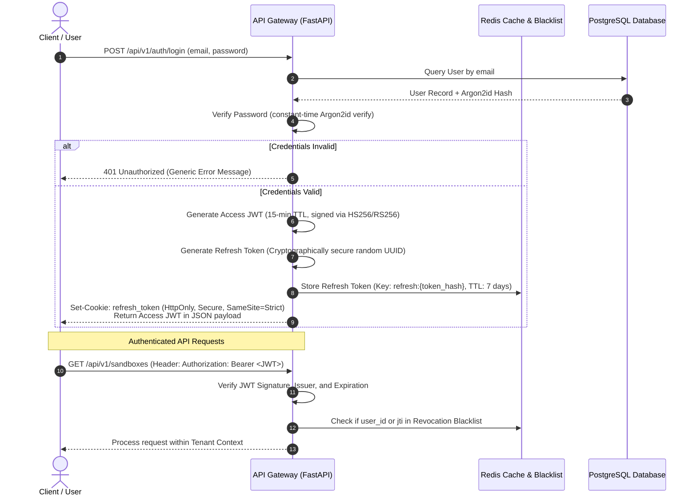

# Security Architecture & Multi-Tenant Defense-in-Depth

## 1. Threat Model & Security Principles

As a multi-tenant platform orchestrating infrastructure failures, the system must withstand severe threat vectors: malicious or runaway chaos experiments, cross-tenant data exfiltration, lateral network movement within the Kubernetes cluster, privilege escalation to host nodes, and token theft.

The security architecture operates under five foundational principles:

1. **Principle of Least Privilege (PoLP):** Every component, service account, and tenant user operates with the minimum set of permissions necessary to execute its role.
2. **Defense-in-Depth:** Security controls are layered across the edge (TLS/WAF), API gateway, application domain logic, database queries, and Kubernetes infrastructure. The failure of any single boundary must not compromise the system.
3. **Strict Zero-Trust Networking in Sandboxes:** Sandbox workloads are untrusted by default. All inter-namespace traffic is blocked, and access to host Kubernetes API servers is severed.
4. **Zero Arbitrary Execution Policy:** Under **no circumstances** will the platform execute raw, user-supplied shell/bash commands or arbitrary Docker container overrides. All experiments are constrained to strongly-typed, pre-validated parameters executed via structured APIs.
5. **Logical Namespace Isolation vs. Strong Boundary Acknowledgment:** The platform explicitly recognizes that Kubernetes namespaces provide **logical resource and network partitioning**, but do **not** constitute a hardware-isolated security sandbox (since the Linux kernel is shared). Strong boundaries are enforced via Pod Security Standards, cgroup limits, and unprivileged user runtimes.

---

## 2. Authentication & JWT Lifecycle



### 2.1 Password Hashing Specification
- Algorithm: **Argon2id** (RFC 9106 recommended configuration).
- Parameters: Memory cost $m = 65,536\text{ KiB}$ (64 MiB), time iterations $t = 3$, parallelism factor $p = 4$.
- Defense: Highly resistant to GPU/ASIC cracking and side-channel timing attacks.

### 2.2 JWT Token Architecture
- **Access Tokens:**
  - Standard Claims: `sub` (User UUID), `tenant_id` (Active Tenant UUID), `role` (`TenantOwner` / `Engineer` / `Viewer`), `exp` (15 minutes), `iat`, `jti` (Token UUID).
  - Storage: In-memory client storage (React state); strictly never stored in browser `localStorage` or `sessionStorage` (preventing XSS persistence).
- **Refresh Tokens:**
  - Format: Cryptographically secure 256-bit random tokens hashed with SHA-256 before storage in Redis.
  - Delivery: Transmitted exclusively via `HttpOnly; Secure; SameSite=Strict; Path=/api/v1/auth` cookies.
  - Revocation: Upon logout or password reset, all active refresh tokens for the user in Redis are purged, and the user ID is added to a 15-minute JWT revocation blacklist.

---

## 3. Role-Based Access Control (RBAC) & Tenant Isolation

### 3.1 Permission Matrix

| Action / Capability | Viewer | Engineer | TenantOwner |
| :--- | :---: | :---: | :---: |
| View Topologies, Sandboxes, Experiments, Incidents, Reports | Yes | Yes | Yes |
| Create / Edit / Delete Topologies | No | Yes | Yes |
| Provision / Delete Sandboxes | No | Yes | Yes |
| Create / Configure Chaos Experiments | No | Yes | Yes |
| Run / Stop Chaos Experiments | No | Yes | Yes |
| Trigger Incident Analysis (Deterministic RCA & AI) | No | Yes | Yes |
| Export / Download Post-Mortem Reports | Yes | Yes | Yes |
| Invite Members / Assign Roles | No | No | Yes |
| Delete Tenant / Modify Quotas | No | No | Yes |

### 3.2 Tenant Isolation at the Data Layer
Every database model (except global `users` and `tenants`) includes a non-nullable `tenant_id` foreign key.
- **Enforcement Pattern:** Application dependency injection guarantees tenant scoping:
  ```python
  # Core dependency pattern in FastAPI
  async def get_current_tenant_membership(
      token_payload: TokenPayload = Depends(verify_jwt_token),
      db: AsyncSession = Depends(get_db_session)
  ) -> TenantMembership:
      membership = await db.scalar(
          select(TenantMembership).where(
              TenantMembership.user_id == token_payload.user_id,
              TenantMembership.tenant_id == token_payload.tenant_id
          )
      )
      if not membership:
          raise HTTPException(status_code=403, detail="Access to specified tenant denied.")
      return membership
  ```
- **Query Invariant:** All `SELECT`, `UPDATE`, and `DELETE` queries dynamically append `.where(Model.tenant_id == current_membership.tenant_id)`. Zero raw SQL strings are permitted.

---

## 4. Kubernetes Infrastructure Security

### 4.1 Pod Security Standards & Hardening
Every sandbox namespace is labeled with Pod Security Standard baseline and restricted policies:
```yaml
apiVersion: v1
kind: Namespace
metadata:
  name: sandbox-acme-3fa85f64
  labels:
    pod-security.kubernetes.io/enforce: baseline
    pod-security.kubernetes.io/audit: restricted
    pod-security.kubernetes.io/warn: restricted
```

All microservice and sidecar container specifications must enforce:
```yaml
securityContext:
  allowPrivilegeEscalation: false
  runAsNonRoot: true
  runAsUser: 10001
  runAsGroup: 10001
  readOnlyRootFilesystem: true
  capabilities:
    drop:
      - ALL
```
- **ServiceAccount Tokens Severed:** Containers are blocked from communicating with the Kubernetes API server by disabling token automounting:
  ```yaml
  automountServiceAccountToken: false
  ```

### 4.2 Network Isolation Policies
By default, Kubernetes allows all pods to communicate across all namespaces. The platform actively disables this using an automated default-deny `NetworkPolicy` deployed into every sandbox namespace upon creation:

```yaml
apiVersion: networking.k8s.io/v1
kind: NetworkPolicy
metadata:
  name: default-deny-isolate
  namespace: sandbox-acme-3fa85f64
spec:
  podSelector: {}
  policyTypes:
    - Ingress
    - Egress
  ingress:
    # Allow intra-namespace traffic between sibling microservices
    - from:
        - podSelector: {}
    # Allow control plane Celery workers to reach Toxiproxy on port 8474
    - from:
        - namespaceSelector:
            matchLabels:
              kubernetes.io/metadata.name: chaos-control-plane
      ports:
        - protocol: TCP
          port: 8474
  egress:
    # Allow intra-namespace traffic
    - to:
        - podSelector: {}
    # Allow DNS resolution
    - to:
        - namespaceSelector:
            matchLabels:
              kubernetes.io/metadata.name: kube-system
      ports:
        - protocol: UDP
          port: 53
    # Allow OTLP telemetry push to OTel Collector in control plane
    - to:
        - namespaceSelector:
            matchLabels:
              kubernetes.io/metadata.name: chaos-control-plane
          podSelector:
            matchLabels:
              app.kubernetes.io/name: opentelemetry-collector
      ports:
        - protocol: TCP
          port: 4317
```

### 4.3 Control Plane Kubernetes RBAC
The control plane backend utilizes a dedicated Kubernetes `ServiceAccount` bound to a scoped `ClusterRole`:
- **Allowed Verbs:** `get`, `list`, `watch`, `create`, `update`, `patch`, `delete`.
- **Allowed Resources:** `namespaces`, `deployments`, `services`, `resourcequotas`, `limitranges`, `networkpolicies`, `pods`.
- **Cluster Role Binding Invariant:** The backend cannot modify cluster nodes, CRDs, mutating webhooks, cluster roles, or namespaces outside the `sandbox-*` namespace prefix.

---

## 5. Experiment Safety & Global Kill Switch

### 5.1 Experiment Safety Envelopes
To prevent unintentional cluster degradation, all experiment parameters are validated against immutable safety boundaries before execution:
- Maximum duration: $\le 600\text{ seconds}$ (10 minutes).
- Maximum network latency injection: $\le 5,000\text{ ms}$.
- Maximum packet loss: $\le 50\%$.
- Maximum CPU stress: $\le 2\text{ cores}$ per pod.
- Concurrency limit: Maximum 1 active experiment run per sandbox; maximum 3 concurrent experiment runs per tenant.

### 5.2 Global Kill Switch (Emergency Stop)
If an experiment causes runaway resource consumption or unintended behavior, operators have access to a three-tier Kill Switch:
1. **Tier 1 (API Stop):** `POST /api/v1/experiments/{id}/stop` flags the experiment in Redis and directs the owning worker to delete the active toxic within $\le 3\text{ seconds}$.
2. **Tier 2 (Tenant Emergency Flush):** `POST /api/v1/tenants/{id}/kill-switch` directs all workers to immediately flush all active toxics and terminate all stress containers across all sandboxes owned by the tenant.
3. **Tier 3 (Namespace Isolation):** If Toxiproxy is unresponsive, the platform dynamically patches the sandbox `NetworkPolicy` to isolate the offending pod or issues a forced pod restart.

---

## 6. Audit Logging & Compliance

Every state-mutating operation generates an immutable record in the `audit_logs` table:
- Capture parameters: User ID, Tenant ID, Action, Resource Type, Resource ID, Client IP, User-Agent, Timestamp, and Payload Diff.
- Critical audited actions:
  - `AUTH_LOGIN_SUCCESS` / `AUTH_LOGIN_FAILED`
  - `SANDBOX_PROVISIONED` / `SANDBOX_DELETED`
  - `EXPERIMENT_STARTED` / `EXPERIMENT_STOPPED`
  - `TOXIC_INJECTED` / `TOXIC_REMOVED`
  - `KILL_SWITCH_TRIGGERED`
  - `TENANT_ROLE_UPDATED`
- Audit records are append-only. No API endpoint or application user is granted `UPDATE` or `DELETE` permissions on `audit_logs`.
