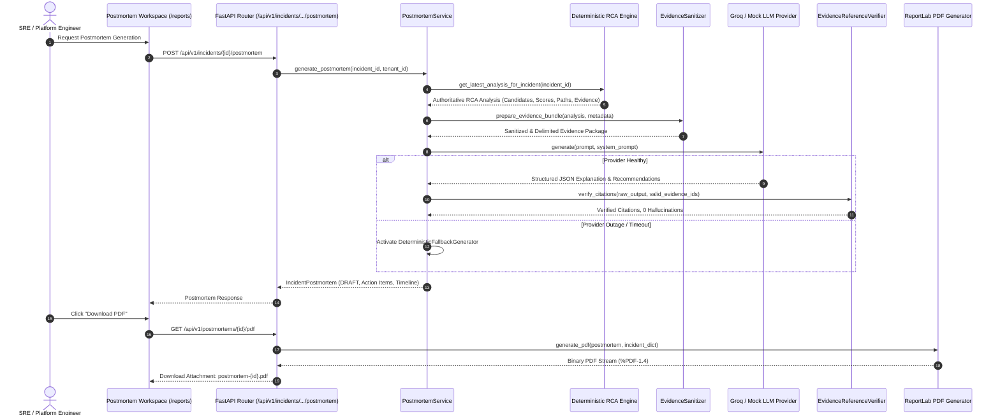

# Milestone M9 — AI-Assisted RCA Explanation & Postmortem Generation

## 1. Architectural Boundary & Core Principles

ChaosEngine AI implements a strict architectural separation between **deterministic diagnosis** and **AI-assisted narrative synthesis**:

1. **M8 as the Single Authoritative Source of Truth:**
   The deterministic Root Cause Analysis (RCA) engine developed in Milestone M8 is the sole authority for candidate generation, mathematical scoring (0–100), ranking, confidence classification (`HIGH`, `MEDIUM`, `LOW`, `INCONCLUSIVE`), and failure propagation directed acyclic graphs (DAGs). Milestone M9 **never** alters, overrides, or recalculates M8's conclusions.
2. **LLM as an Explanation and Postmortem Layer:**
   The Large Language Model (Groq Llama-3.3-70b-versatile or Mock provider) functions strictly as a narrative synthesizer, technical explainer, and incident report generator.
3. **Evidence Grounding Requirement:**
   Every technical assertion in generated explanations must reference verified evidence markers (`evidence_id`) originating from M4 topology, M5 experiments, M6 metrics/traces/logs, and M7 incident packages. Speculation without evidence is systematically prevented.
4. **Human-in-the-Loop Remediation:**
   All recommendations produced by M9 require explicit human authorization (`requires_human_approval: true`). Recommendations never auto-execute.
5. **Deterministic Fallback Guarantee:**
   If the LLM provider experiences an outage, network timeout, rate limit, or schema failure, the system seamlessly falls back to the deterministic algorithmic generator, ensuring continuous operational availability.

---

## 2. Component Interaction & Flow

---

## 3. Data Model Summary

- **`AIIncidentExplanation`**:
  - `executive_summary`: High-level summary of the incident and primary cause.
  - `technical_narrative`: Technical analysis citing verified evidence IDs.
  - `failure_propagation_walkthrough`: Step-by-step description of failure traversing topology edges.
  - `recommendations`: Categorized actionable remediation strategies.
  - `cited_evidence_ids`: Discovered and verified evidence references.
  - `hallucination_detected`: Boolean flag indicating if any cited ID was ungrounded.
  - `is_deterministic_fallback`: Indicates whether the fallback synthesizer was utilized.
- **`IncidentPostmortem`**:
  - `primary_root_cause_service`: Authoritative M8 root cause service.
  - `primary_root_cause_score`: Deterministic confidence score (0–100).
  - `deterministic_propagation_path`: Ordered list of impacted services from fault origin to ingress.
  - `action_items`: Editable action items with priority, status, assignee, and due date.
  - `status`: Lifecycle status (`DRAFT`, `IN_REVIEW`, `APPROVED`, `PUBLISHED`).
