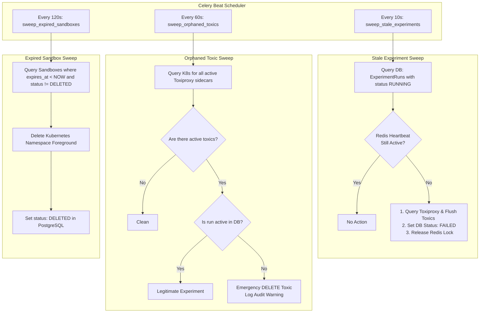

# Failure, Reliability & Disaster Recovery Design

## 1. Reliability Philosophy & Core Tenets

Distributed systems inevitably fail. Rather than assuming components remain permanently healthy, the platform is engineered to expect failure at every tier:
1. **Crash-Only Design:** Every component must be able to crash abruptly (`SIGKILL`) and restart without human intervention or data corruption.
2. **Stateless Workers & Durable State:** Workers hold zero critical in-memory state. Transient state resides in Redis with TTLs; durable state resides in PostgreSQL.
3. **Idempotent Infrastructure Operations:** Every operation (creating a namespace, applying a network policy, creating or deleting a toxic) must produce the exact same outcome whether called once or ten times.
4. **Autonomous Reconciliation Loops:** The system does not assume that background jobs always complete. Periodic reconciliation workers continuously compare desired state against actual infrastructure state, sweeping orphaned resources and reconciling broken runs.

---

## 2. Failure Scenarios Matrix (12 Scenarios Analyzed)

### Scenario 1: FastAPI Control Plane API Crashes
- **Failure Detection:** Kubernetes liveness/readiness probes (`GET /healthz`) fail 3 consecutive times over 15 seconds; process supervisor (systemd / Docker) catches exit code.
- **Expected Behavior:** In-flight HTTP requests fail with `502 Bad Gateway` at the ingress/reverse proxy level. Background experiments and running sandboxes continue operating uninterrupted.
- **Retry Strategy:** Client-side HTTP retries with exponential backoff and jitter for idempotent `GET` endpoints.
- **Recovery Strategy:** Kubernetes automatically restarts the API container replica. Ready in $< 5\text{ seconds}$. Database connection pools re-establish automatically.
- **Data Consistency:** Zero data corruption. Uncommitted database transactions roll back via PostgreSQL ACID guarantees.
- **User-Visible Status:** Frontend displays a non-blocking toast: *"Reconnecting to control plane..."* with automatic reconnection polling.

---

### Scenario 2: PostgreSQL Database Becomes Unavailable
- **Failure Detection:** `asyncpg` raises `CannotConnectNowError`, `ConnectionRefusedError`, or query timeout ($> 5\text{s}$). Health check endpoint flags unhealthy.
- **Expected Behavior:** API enters read-only/error mode, rejecting mutating requests with `503 Service Unavailable`. Active Celery experiment workers pause non-critical database writes and buffer status in Redis.
- **Retry Strategy:** Connection pool retries connecting every 2 seconds with exponential backoff up to 30 seconds.
- **Recovery Strategy:** Upon PostgreSQL restoration, connection pool recovers automatically. Celery workers flush buffered status updates to PostgreSQL.
- **Data Consistency:** Write-Ahead Log (WAL) ensures committed transactions are completely preserved.
- **User-Visible Status:** Global banner: *"System degradation: Database connectivity interrupted. Telemetry and experiments are safely buffered."*

---

### Scenario 3: Redis In-Memory Datastore Becomes Unavailable
- **Failure Detection:** `redis.exceptions.ConnectionError` raised during Celery dispatch, lock acquisition, or rate-limiting.
- **Expected Behavior:** API rejects new experiment dispatch requests with `503 Service Unavailable` (since locks cannot be acquired). In-flight Celery tasks cannot ack.
- **Retry Strategy:** Celery broker automatic reconnection loop (built-in backoff).
- **Recovery Strategy:** Redis restarts from AOF/RDB persistence. Active locks expire cleanly based on past timestamps.
- **Data Consistency:** Celery tasks configured with `task_acks_late=True` are re-delivered upon Redis reconnection.
- **User-Visible Status:** Error on experiment launch: *"Unable to queue experiment. Task broker temporarily unavailable."*

---

### Scenario 4: A Celery Worker Crashes Mid-Experiment (`SIGKILL` / OOM)
- **Failure Detection:** Distributed Redis heartbeat key `heartbeat:experiment:{run_id}` ceases to update and expires after 15 seconds.
- **Expected Behavior:** The running experiment loses its supervising worker. The injected fault remains active inside the target pod's Toxiproxy sidecar until watchdog intervention.
- **Retry Strategy:** Task is NOT blindly retried on another worker to avoid duplicate injection against an already faulted pod.
- **Recovery Strategy:**
  1. The central **Reconciliation Watchdog Worker** (`workers.reconciler_tasks.sweep_stale_experiments`) wakes up every 10 seconds.
  2. Detects `ExperimentRun` marked as `RUNNING` whose heartbeat has expired.
  3. Directly issues an HTTP call to the target pod's Toxiproxy API to delete all active toxics.
  4. Marks the `ExperimentRun` in PostgreSQL as `FAILED` with reason `WORKER_CRASH_AUTO_RECOVERED`.
  5. Releases the Redis sandbox lock.
- **Data Consistency:** Telemetry up to the point of worker failure is preserved in Prometheus/Jaeger.
- **User-Visible Status:** Experiment run card transitions to `FAILED` with banner: *"Experiment terminated automatically due to worker supervision failure. Injected faults have been safely purged."*

---

### Scenario 5: Kubernetes API Server Becomes Unavailable
- **Failure Detection:** `kubernetes_asyncio.client.exceptions.ApiException` or TCP connection timeout to port 6443.
- **Expected Behavior:** Sandbox provisioning and teardown tasks pause. Running microservice workloads inside already provisioned sandboxes continue executing normally (data plane is decoupled from control plane). Toxiproxy network injection continues normally (communicates directly with pod IP, bypassing K8s API server).
- **Retry Strategy:** Kubernetes client retries with exponential backoff (1s, 2s, 4s, 8s) up to 30s.
- **Recovery Strategy:** Once K8s API server responds, queued provisioning tasks resume rollout tracking.
- **Data Consistency:** Sandbox state remains `PROVISIONING` until verified ready.
- **User-Visible Status:** Provisioning spinner remains active with status message: *"Awaiting Kubernetes API response..."*

---

### Scenario 6: A Pod Crashes During an Experiment (App Container Crash)
- **Failure Detection:** Kubernetes emits `PodFailed` / `CrashLoopBackOff` event; Prometheus reports target service HTTP request rate dropping to zero.
- **Expected Behavior:** If the crashed container is the target of the experiment, the experiment cannot evaluate meaningful downstream degradation.
- **Retry Strategy:** None.
- **Recovery Strategy:**
  - Experiment runner catches the pod state change via background health check.
  - Automatically terminates the experiment run, marks status as `FAILED` (Reason: `TARGET_POD_CRASHED`), and removes all toxics from the sidecar.
  - Kubernetes `Kubelet` restarts the crashed application container according to its `restartPolicy: Always`.
- **Data Consistency:** Container crash logs captured in Loki for post-mortem debugging.
- **User-Visible Status:** Experiment timeline flags an event: *"Target container crashed. Experiment aborted safely."*

---

### Scenario 7: Toxiproxy Sidecar Becomes Unavailable / Unresponsive
- **Failure Detection:** HTTP connection to `http://<pod_ip>:8474` times out ($> 3\text{ seconds}$).
- **Expected Behavior:** Fault cannot be confirmed or deleted via standard proxy management API.
- **Retry Strategy:** Retry HTTP request 3 times with 1-second intervals.
- **Recovery Strategy:**
  - If Toxiproxy remains dead after 3 retries, the worker invokes the Kubernetes API to delete the entire pod: `delete_namespaced_pod(name, namespace)`.
  - The Deployment controller immediately provisions a brand-new, clean replacement pod with clean network sockets.
  - Marks experiment run as `FAILED`.
- **Data Consistency:** Eliminates any possibility of a "stuck" toxic permanently degrading the service.
- **User-Visible Status:** *"Fault injection proxy unresponsive. Pod was automatically restarted to guarantee clean recovery."*

---

### Scenario 8: An Experiment Exceeds Its Configured Duration (Runaway Experiment)
- **Failure Detection:** Worker timer reaches `duration_seconds`; watchdog identifies run whose `started_at + duration_seconds + 30s < NOW()`.
- **Expected Behavior:** Automatic, non-negotiable fault removal.
- **Retry Strategy:** Hard timeout enforced by Celery `soft_time_limit` and `time_limit`.
- **Recovery Strategy:** Worker executes `delete_toxic()`. If worker has hung, the reconciliation watchdog executes emergency deletion.
- **Data Consistency:** Run status set to `COMPLETED` (or `TIMED_OUT`).
- **User-Visible Status:** Status transitions cleanly from `RUNNING` to `COMPLETED`.

---

### Scenario 9: Telemetry Ingestion Pipeline Fails (OTel Collector / Prometheus Down)
- **Failure Detection:** PromQL query returns HTTP 500 / connection refused during incident evaluation.
- **Expected Behavior:** Microservices and experiments continue executing, but incident detection and metric dashboards cannot update.
- **Retry Strategy:** Retries every 5 seconds.
- **Recovery Strategy:** OTel Collector buffers traces in memory up to `limit_percentage: 80`. When Prometheus/Jaeger recover, metrics resume scraping. The incident evaluator flags an "Observability Gap" warning on any incident detected during the outage window.
- **Data Consistency:** Historical metrics during collector downtime may have a gap, but database entity records remain intact.
- **User-Visible Status:** Amber warning badge on dashboard: *"Telemetry stream delayed. Reconnecting to metrics server..."*

---

### Scenario 10: LLM Provider (Groq API) is Unavailable / Rate-Limited
- **Failure Detection:** Groq SDK raises `APIConnectionError`, `RateLimitError` (HTTP 429), or `InternalServerError` (HTTP 500).
- **Expected Behavior:** Deterministic RCA completes normally. Only the natural language post-mortem narrative fails.
- **Retry Strategy:** Single retry with 2-second backoff.
- **Recovery Strategy:**
  - The system catches the exception and falls back to a deterministic template narrative:
    ```
    "Deterministic RCA identified [service_name] as the primary root cause with [confidence]% confidence. AI narrative generation is temporarily unavailable due to upstream provider rate limits."
    ```
  - Incident status updates to `ANALYZED`. The user is never blocked from reviewing root cause rankings or trace waterfalls.
- **Data Consistency:** Deterministic candidate rankings and evidence are fully persisted in `rca_reports`.
- **User-Visible Status:** Full deterministic post-mortem rendered with an informational pill: *"AI Explanation Offline — Showing Algorithmic RCA"*.

---

### Scenario 11: Deterministic RCA Analysis Fails (e.g., Corrupted Trace Data)
- **Failure Detection:** RCA engine catches unhandled data parsing error or empty trace array during analysis window.
- **Expected Behavior:** Engine degrades gracefully to topological graph analysis and temporal metric Z-scores, omitting trace span self-time calculations.
- **Retry Strategy:** Re-queries Prometheus and Jaeger with an expanded 5-minute time window.
- **Recovery Strategy:** Confidence scores are calibrated downward with a data completeness penalty ($\text{confidence} = \text{score} \times 0.6$). Report documents: *"Analyzed with partial trace data."*
- **Data Consistency:** Prevents uncaught exceptions from failing the `POST /incidents/{id}/analyze` request.
- **User-Visible Status:** Results display with confidence warning: *"Moderate Confidence (Limited trace context available)"*.

---

### Scenario 12: Fault Cleanup Fails (Toxiproxy Deletion Returns Error)
- **Failure Detection:** `DELETE /proxies/{svc}/toxics/{name}` returns HTTP 500 or times out.
- **Expected Behavior:** System initiates emergency pod restart protocol.
- **Retry Strategy:** Retries 3 times over 3 seconds.
- **Recovery Strategy:**
  - Platform issues immediate Kubernetes API call: `delete_namespaced_pod()`.
  - Deployment controller rolls a fresh pod with zero active toxics.
  - Incident and run records log `CLEANUP_POD_RESTART_FORCED`.
- **Data Consistency:** Guarantees zero residual network degradation.
- **User-Visible Status:** Run marked `COMPLETED` with audit note: *"Service restored via automated pod recycling."*

---

## 3. Autonomous Reconciliation Architecture



The combination of stateless workers, distributed heartbeats, and autonomous background reconciliation guarantees that **no experiment can remain stuck, no toxic can leak indefinitely, and no orphaned namespace can consume cluster resources permanently**.
