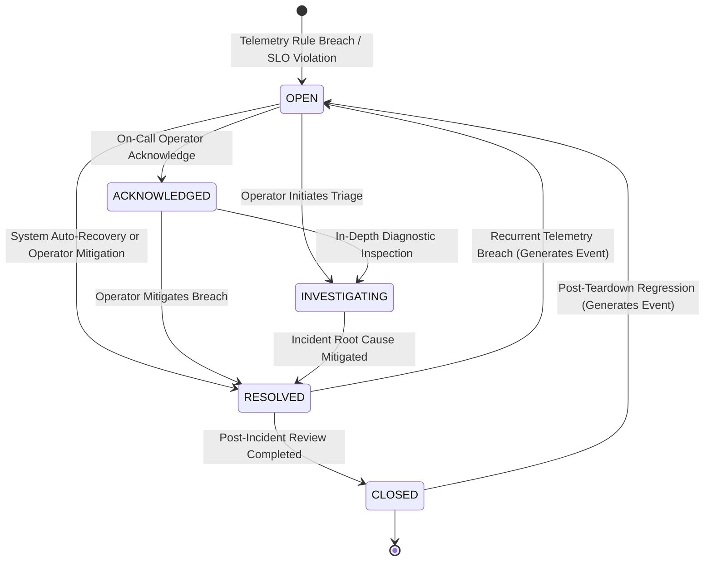

# Incident Lifecycle State Machine & Audit Model (Milestone M7)

## 1. Lifecycle State Machine Definition

ChaosEngine AI enforces a deterministic, formal finite state machine for all incidents across their operational lifecycle.



---

## 2. Transition Rules and Invariants

| From State | Allowed Target States | Permitted Actors | Preconditions & Actions |
|---|---|---|---|
| `OPEN` | `ACKNOWLEDGED`, `INVESTIGATING`, `RESOLVED` | `Engineer`, `TenantOwner`, `SYSTEM` | Sets `acknowledged_at` and assigns to operator; appends `IncidentLifecycleEvent`. |
| `ACKNOWLEDGED` | `INVESTIGATING`, `RESOLVED` | `Engineer`, `TenantOwner` | Operator claims ownership and attaches initial diagnostic notes. |
| `INVESTIGATING` | `RESOLVED` | `Engineer`, `TenantOwner` | Transitioned when mitigation has been deployed or active chaos fault halted. |
| `RESOLVED` | `CLOSED`, `OPEN` | `Engineer`, `TenantOwner`, `SYSTEM` | Sets `closed_at`. If telemetry breaches reoccur, incident is reopened with an audit log. |
| `CLOSED` | `OPEN` | `Engineer`, `TenantOwner` | Reopens a historical incident if identical fingerprint triggers post-review. |

### Illegal Transitions
Attempting an invalid transition (e.g. `OPEN` directly to `CLOSED`) is rejected at the API boundary with `HTTP 400 Bad Request` and detailed error message:
```json
{
  "detail": "Invalid lifecycle transition: cannot move incident from OPEN to CLOSED."
}
```

---

## 3. Immutable Lifecycle Event Audit Trail

Every transition appends an immutable `IncidentLifecycleEvent` record:

```json
{
  "id": "3fa85f64-5717-4562-b3fc-2c963f66afa6",
  "incident_id": "9b1deb4d-3b7d-4bad-9bdd-2b0d7b3dcb6d",
  "from_status": "OPEN",
  "to_status": "ACKNOWLEDGED",
  "triggered_by": "11111111-1111-1111-1111-111111111111",
  "timestamp": "2026-11-20T12:00:00Z",
  "note": "Acknowledged by on-call SRE lead. Correlating with toxiproxy latency fault."
}
```

This audit log ensures compliance, traceability, and accurate Mean Time to Acknowledge (MTTA) and Mean Time to Resolve (MTTR) calculation.
