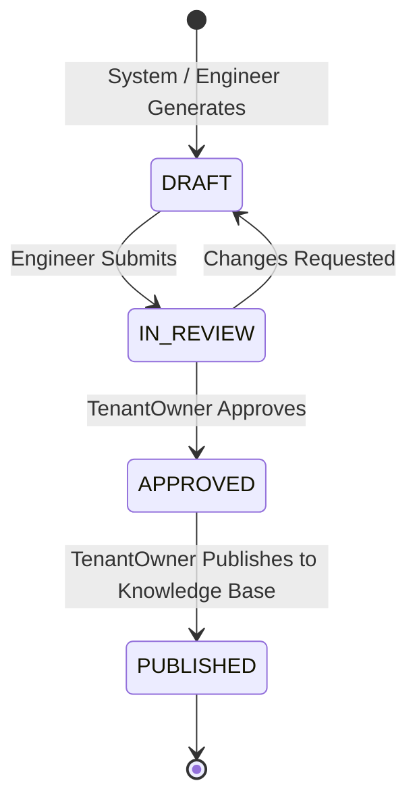

# Incident Postmortem Generation & ReportLab PDF Export (Milestone M9)

## 1. Postmortem Report Lifecycle

ChaosEngine AI postmortems progress through a formal governance state machine:

### RBAC Governance Matrix
| Role | View Postmortem | Edit Action Items | Submit for Review | Approve Postmortem | Publish Postmortem |
| :--- | :---: | :---: | :---: | :---: | :---: |
| **Viewer** | Yes | No | No | No | No |
| **Engineer** | Yes | Yes | Yes | No | No |
| **TenantOwner** | Yes | Yes | Yes | **Yes** | **Yes** |

---

## 2. ReportLab Vector PDF Engine

PDF documents are generated on the server using Python's `reportlab` library:
- **Layout**: Standard Letter page with 0.5-inch margins.
- **Typography**: Clean Helvetica headings with Enterprise SRE dark-slate aesthetics (`#18181b` headers, `#4f46e5` section titles, `#71717a` secondary text).
- **Executive Summary Table**: Summarizes Incident ID, Severity, Affected Service, Target SLO, Root Cause Service, Confidence Score, and Approval signatures.
- **Failure Walkthrough**: Clearly separates M8 deterministic findings and propagation paths from AI narrative synthesis.
- **Corrective Action Items Table**: Formats priority with color badges (P0 Critical in red, P1 High in amber, P2 Medium in blue), full descriptions, status, assignees, and deadlines.
- **Audit Governance Sign-Off Block**: Contains Prepared By, Approved By, Published By, and exact UTC timestamps.
- **Stream Delivery**: Streamed as binary `application/pdf` with attachment header for instant browser download.
